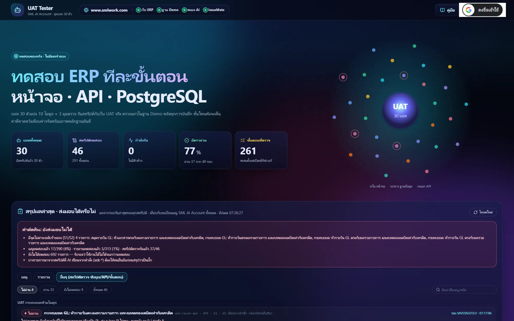
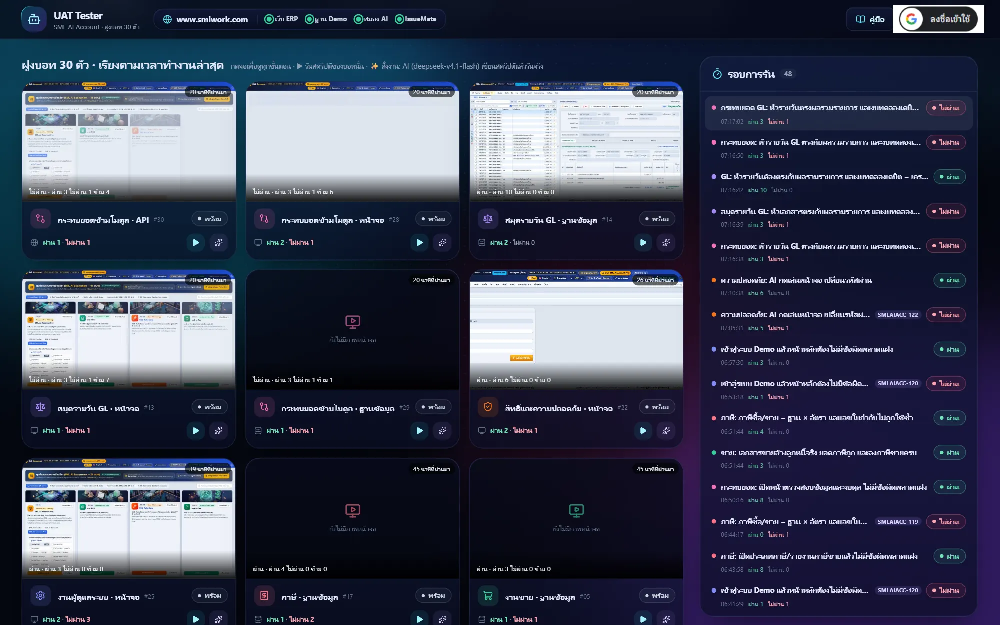
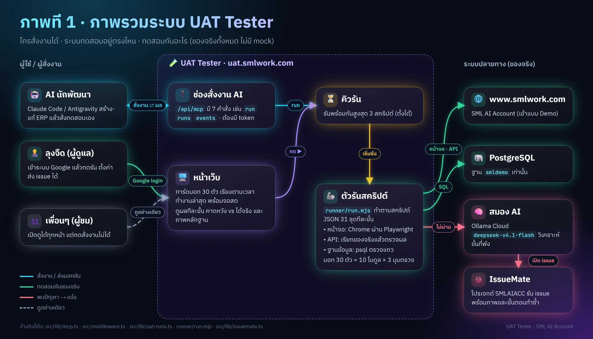
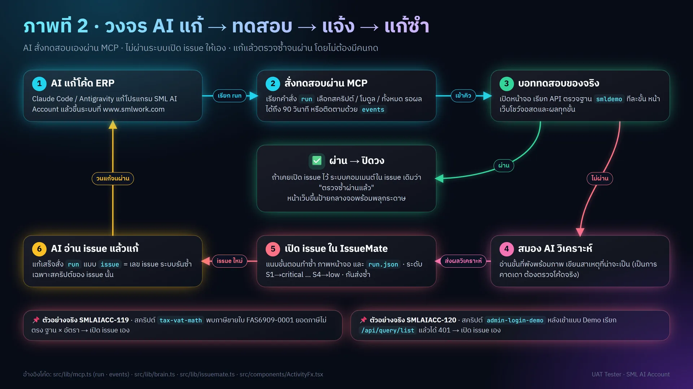
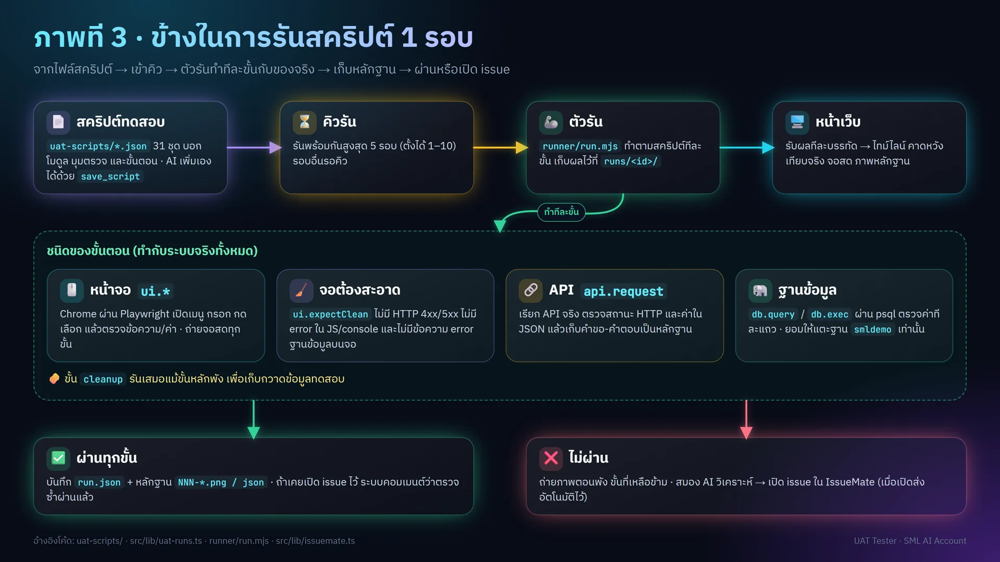
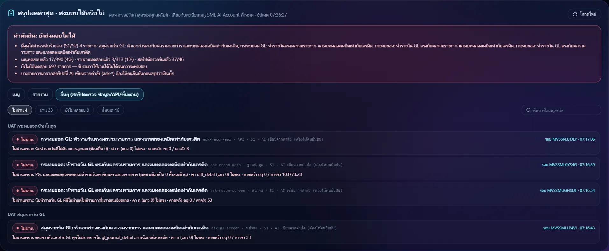
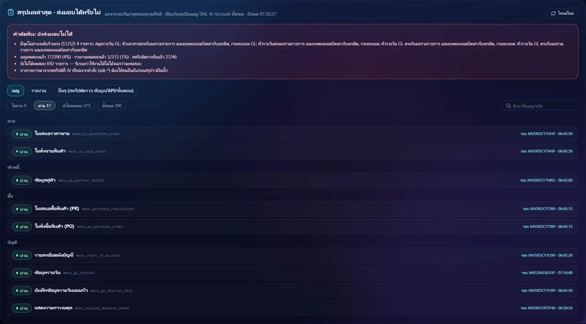
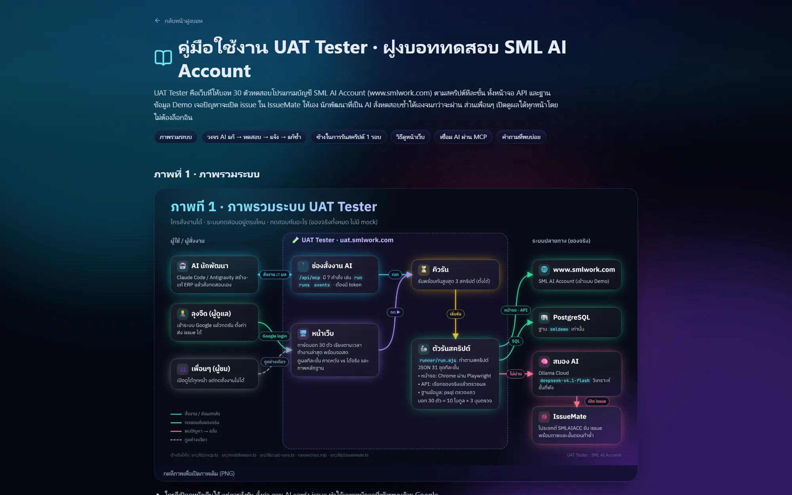

# UAT Tester · SML AI Account (ฝูงบอททดสอบ 30 ตัว)



> ภาพทั้งหมดในไฟล์นี้เป็นภาพหน้าจอจริงจาก https://uat.smlwork.com (มุมมองสาธารณะ ไม่ได้ล็อกอิน) ถ่ายเมื่อ 2026-10-29
>
> repo นี้ไม่มีค่าลับ: รหัสผ่าน, token และ API key อยู่ใน `.env.local` ของแต่ละเครื่องเท่านั้น (ถูก `.gitignore`) — เริ่มจาก `cp .env.example .env.local` แล้วใส่ค่าจริงเอง

## Objective
ทดสอบระบบ SML AI Account แบบ UAT กับของจริง (ไม่มีผลจำลอง) โดยรันสคริปต์ทีละขั้นตอนที่เขียนไว้ ตรวจได้ทั้งหน้าจอ, API และแถวใน PostgreSQL ของฐาน Demo
รอบที่ไม่ผ่านจะให้สมอง AI (Ollama Cloud) วิเคราะห์ แล้วเปิด issue ใน IssueMate (โปรเจกต์ SMLAIACC) ให้ทีมแก้โปรแกรมต่อ

- ตัว Tester อยู่ที่ https://uat.smlwork.com และทดสอบเว็บ https://www.smlwork.com (เข้าแบบ Demo / ฐาน `smldemo`)
- AI ที่เขียนโปรแกรม (Claude, Antigravity บนเครื่องลุงจืด) สั่งงานผ่าน MCP วงจรคือ
  1. AI สั่งตรวจ → Tester รันกับของจริง
  2. ไม่ผ่าน → เปิด issue ใน IssueMate · ขั้นที่ทำซ้ำแล้วข้อมูลไม่เปลี่ยน (ตรวจ/อ่าน/เปิดจอ/กรอก/เลือก/PDF/`db.query`/`api.request` GET) ล้มแล้วลองซ้ำอีกสูงสุด 2 ครั้ง ห่างกัน 3 วินาที — ผ่านตอนลองซ้ำ = ป้าย "ผ่านเมื่อลองซ้ำ" (flaky) ไม่นับเป็นบั๊ก (`attempt` ใน `runner/run.mjs`) · ยกเว้นทุกขั้นที่พัง (ไม่นับเก็บกวาด) พังเพราะตัวสคริปต์เอง: `psql ผิดพลาด`, `ไม่มีตัวแปร {{…}}`, `AI ทำไม่จบใน N ตา`, ขั้นเตรียมข้อมูล `db.query` ได้ 0 แถวก่อนแตะ ERP, `api.request` ได้ 404 หน้า HTML/405/400 "กรุณาระบุ…", เปิดเมนูที่ไม่มีใน ERP → ไม่เปิด issue แต่บันทึกเหตุการณ์ในบอท และขึ้นเหตุผลบนการ์ดบอท/หน้ารอบ (`noIssue`) ให้แก้สคริปต์ (`scriptFault` ใน `src/lib/script-fault.ts`, ตัวตรวจ `node scripts/check-script-fault.mjs`, รอบตรวจซ้ำของ issue ยังส่งผลเสมอ) · สคริปต์ `auto-*` ที่ AI เสนอเองก็ไม่เปิด issue อัตโนมัติ (เปิด ticket ไม่จริงบ่อย) — ตรวจผลก่อนแล้วกด "ส่งเข้า IssueMate" ที่หน้ารอบ · สคริปต์ที่ AI เขียน (`ask-*` และที่บันทึกผ่าน MCP `save_script` ซึ่งไฟล์มี `"ai": true`) ผ่านด่าน AI ก่อน (`aiTriage`): ชี้ชัดว่าสคริปต์ผิดเอง → ไม่เปิด issue แต่กดส่งเองได้, ระบบผิด/ไม่แน่ใจ → เปิดตามเดิม · สคริปต์ AI ที่ชี้ว่าผิดเอง AI จะซ่อมให้ (`healScript` ใน `src/lib/command.ts`): เขียนฉบับแก้ลง `runs/<รอบ>/heal.json` ผ่านตัวตรวจเดียวกับ `save_script` แล้วรันลองจากไฟล์นั้น (รายการรอบมีป้าย "AI ซ่อม") — รอบลองผ่านหรือไปถึงจุดที่ ERP ผิดจริงจึงบันทึกทับสคริปต์เดิม (`promoteHeal`), รอบลองยังพังเอง = ทิ้ง ไม่ซ่อมต่อ (ตัวตรวจ `node scripts/check-heal.mjs`) · สั่งส่งเองได้ด้วย MCP `runs {id, action:"issue"}`
  3. AI แก้โค้ด แล้วสั่งตรวจซ้ำด้วยเลข issue
  4. ผ่าน → Tester เขียนคอมเมนต์ปิดวงจรใน issue นั้น (ไม่ผ่าน → คอมเมนต์ว่ายังพังขั้นไหน)
- บทบาทของ AI (ทั้งสมองบอทและคำแนะนำใน MCP): คนไทย เป็นผู้ใช้ทั่วไปของ SML AI Account ที่ทำงานแบบผู้ใช้จริง และเก่ง query กับ data model ตรวจฐานข้อมูลและ flow งานได้ (เช่น ใบเสนอราคา → ใบสั่งขาย → ใบขาย → ภาษีขาย → GL → สต็อก)

ฝูงบอทมี 30 ตัว = 10 โมดูล × 3 มุมตรวจ
- โมดูล: master, sales, purchase, inventory, gl, tax, reports, security, admin, recon
- มุมตรวจ: หน้าจอ (screen), ฐานข้อมูล (data), API (api)

ข้อมูลบอทอยู่ใน `src/lib/swarm-data.ts`



## Workflow

ภาพรวมระบบ (ใครสั่งงานได้ · ระบบทดสอบอยู่ตรงไหน · ทดสอบกับอะไร):



วงจร AI แก้ → ทดสอบ → แจ้ง → แก้ซ้ำ:



ข้างในการรันสคริปต์ 1 รอบ:



1. กด ▶ ที่บอท/สคริปต์ หรือ "รันทุกสคริปต์" → เข้าคิว (`src/lib/uat-runs.ts`) รันพร้อมกันตาม "รันพร้อมกันสูงสุด"
2. แต่ละรอบเรียก `node runner/run.mjs --script <ไฟล์> --out runs/<id> --base <เว็บ ERP>` ซึ่งใช้ Playwright เปิดเว็บและใช้ psql ตรวจฐานข้อมูล
   - ตัวรันพิมพ์ผลทีละบรรทัด (JSON) → หน้าจอแสดงไทม์ไลน์ขั้นตอน ค่าที่คาดหวังเทียบค่าจริง และภาพหลักฐาน
   - ขั้น `cleanup` รันเสมอแม้ขั้นหลักพัง
   - หลังทุกขั้นที่เป็นหน้าจอ (`ui.*`) ตัวรันเขียนทับภาพ `runs/<id>/live.jpg` → การ์ดบอทบนหน้าแรกโชว์จอสดว่ากำลังทำอะไร (การ์ดเรียงบอทที่กำลังรันก่อน แล้วตามเวลาทำงานล่าสุด, `src/components/BotCard.tsx`)
   - ขั้นที่ไม่มีหน้าจอ (`db.*`, `api.request`, `report.pdf`) ตัวรันส่งคำสั่งจริงที่เติมตัวแปรแล้ว (`query`, ตัดที่ 600 ตัว ปิดค่าลับ) · issue ที่เปิดก็แนบคำสั่งนี้ไปด้วย
   - การ์ดเล่ารอบล่าสุดของบอทรอบเดียว (ภาพ คำสั่ง ข้อความบนจอ และการกดดูขั้นตอนมาจากรอบเดียวกัน ไม่หยิบภาพรอบเก่า): เลือกขั้นที่จะเล่า = ขณะรันคือขั้นที่กำลังทำ, จบแล้วคือขั้นที่ไม่ผ่าน หรือขั้นสุดท้ายที่รันจริง (ไม่นับเก็บกวาด) → ขั้นนั้นมีคำสั่ง SQL/API ก็โชว์คำสั่ง ไม่งั้นโชว์ `live.jpg` ของรอบนั้น · ข้อความล่างจอ เช่น "ไม่ผ่านขั้น 8/12 · …" นับเป็นขั้น ส่วนแถวล่างการ์ด "ผ่าน 4 รอบ · ไม่ผ่าน 1 รอบ" นับเป็นรอบ
   - ปุ่มขยายจอ (มุมขวาบนของจอการ์ด ข้างเวลา) → จอเดียวกันขยายเต็มหน้าแบบแอนิเมชันซูมออกจากตำแหน่งการ์ด เห็นภาพทั้งจอไม่ครอป/เลื่อนอ่านคำสั่ง SQL ยาวได้ และยังอัปเดตสดขณะรัน · ปิดด้วย Esc, ปุ่ม X หรือคลิกพื้นหลัง (หดกลับเข้าการ์ด)
3. ผลถาวรเก็บที่ `runs/<id>/run.json` พร้อมไฟล์หลักฐาน `NNN-*.png|json|pdf`
   - รอบที่ไม่ผ่านหรือผิดพลาดมีไฟล์เพิ่ม 2 ไฟล์ (`runner/run.mjs` `startRecording`/`stopRecording`):
     - `video.webm`: วิดีโอทั้งรอบ กว้าง 1280 px ที่ 5 fps อัดด้วย `page.screencast` ของ Playwright 1.64 จึงอัดแท็บของ Stagehand ที่ต่อผ่าน CDP ได้ด้วย
     - `trace.zip`: Playwright trace (DOM ทุกขั้น, network, console) เปิดดูทีละคลิกด้วย https://trace.playwright.dev หรือ `npx playwright show-trace trace.zip`
   - รอบที่ผ่าน ตัวรันลบทั้งสองไฟล์ทิ้ง ประหยัดดิสก์
   - หน้ารอบ (`src/components/RunPanel.tsx`) เล่นวิดีโอได้ทันทีและมีปุ่มดาวน์โหลด trace · issue ใน IssueMate และคอมเมนต์รอบที่ยังไม่ผ่านมีลิงก์ทั้งสองไฟล์ (`src/lib/issuemate.ts`)
4. ถ้ารอบนั้น **ไม่ผ่าน** และเปิด "ส่งเข้า IssueMate อัตโนมัติ" ไว้ (`src/lib/issuemate.ts`):
   1. สมอง AI อ่านขั้นที่พังพร้อมภาพหน้าจอ แล้วเขียนบทวิเคราะห์ (เป็นการคาดเดา ต้องตรวจโค้ดจริง)
   2. ระบบเรียก `create_issue` ผ่าน MCP ของ IssueMate โดยตั้งระดับความสำคัญตามระดับปัญหา: S1→critical, S2→high, S3→medium, S4→low
   3. issue ที่สร้างมีขั้นตอนทำซ้ำ บทวิเคราะห์ ภาพหน้าจอ และ run.json แนบไปด้วย
   4. กันส่งซ้ำด้วย `runs/issuemate-sent.json`: สคริปต์เดียว = issue เดียว ถ้ารอบใหม่พังที่ขั้นอื่นจะต่อท้ายผลใน issue เดิม — เมื่อสคริปต์นั้นกลับมาผ่าน ระบบล้างรายการของสคริปต์นั้นเองและคอมเมนต์ใน issue เดิมว่าตรวจซ้ำผ่านแล้ว
   5. รอบที่ผิดพลาด (error) ไม่ส่งอัตโนมัติ ต้องกดส่งเองในแผง "รอบการรัน"
5. "สั่งงานตรวจ" (ปุ่มบนแถบบน, ✨ ที่บอท, MCP tool `command`) — `src/lib/command.ts`
   1. ผู้ดูแลพิมพ์ว่าจะให้ตรวจอะไร ไม่เลือกบอท = สมอง AI เลือกบอทที่เกี่ยวเอง (ไม่เกิน 6 ตัว) · ปุ่มบนแถบบนตอบรับทันทีแล้วทำเบื้องหลัง ผลหรือสาเหตุที่ทำไม่ได้ขึ้นฟีดกิจกรรม ("ระบบสั่งงาน") และลง log
   2. แต่ละบอทเขียนสคริปต์ `ask-<โมดูล>-<มุมตรวจ>` จากคอลัมน์จริงใน PostgreSQL แล้วบันทึกผ่านตัวตรวจเดียวกับ `save_script`
   3. สคริปต์จากคำสั่งอ่านอย่างเดียว: ห้าม `db.exec`, ห้าม `ui.adminLogin`, `api.request` ใช้ GET เท่านั้น · SQL ทุกขั้น `db.query` ถูกลอง `EXPLAIN` กับฐาน Demo ก่อนบันทึก (ไม่รันจริง) ถ้าอ้างตาราง/คอลัมน์ที่ไม่มีจริงให้ AI แก้ใหม่ · ใช้ตัวแปร `{{x}}` ที่ไม่มีขั้นก่อนหน้า save/as/set ไว้ก็ตีกลับให้แก้ (`varGuard`) · ถ้าคำสั่งพูดถึงตารางที่มี `trans_flag` AI จะได้รายชื่อเลข=ประเภทเอกสารจริงจากฟังก์ชัน `trans_flag()` ของ SML ไม่ต้องเดา ไม่ปล่อยไปรันพังแล้วเปิด issue ผิดตัว · รอบที่ไม่ผ่านยังเปิด IssueMate ตาม `autoIssueMate` พร้อมหมายเหตุให้ตรวจสคริปต์ก่อน
   4. เข้าคิวรันจริงทันที · รอบที่ไม่ผ่านผ่านด่าน AI ก่อน (ดูการเปิด issue ด้านบน) แล้วเปิด issue ใน IssueMate อัตโนมัติ (issue ของ `ask-*` มีหมายเหตุให้ตรวจสคริปต์ก่อน)
   5. AI คิดเรื่องทดสอบเพิ่มเอง (on the fly, `proposeScripts`): จบแต่ละชุดทดสอบ สมอง AI ดูผลชุดนั้นกับรายชื่อสคริปต์ที่มี แล้วเสนอไม่เกิน 2 เรื่อง (ขุดต่อจากขั้นที่พัง หรือเรื่องที่ยังไม่มีสคริปต์ตรวจ) → บอทที่ตรงเขียนสคริปต์ `auto-<โมดูล>-<เวลา>` ผ่านตัวตรวจเดียวกับข้อ 3 แล้วเข้าคิวรัน · ชุดที่มีแต่ `auto-*` ไม่เสนอต่อ (ไม่วน) · มี `auto-*` ครบ 30 ไฟล์แล้วหยุดเสนอจนกว่าจะลบ/คัดเข้าคลัง · ปิดได้ที่หน้าตั้งค่า หรือ `UAT_AUTO_SCRIPTS=0`

6. คำสั่งผ่าน MCP (`src/app/api/mcp/route.ts`, `src/lib/mcp.ts`)
   - ปลายทาง `POST /api/mcp` (JSON-RPC) รองรับ MCP 2026-07-28 และ 2025-11-25 / 2025-06-18 / 2025-03-26
   - ยืนยันตัวด้วย `Authorization: Bearer <UAT_MCP_TOKEN>`
   - tools 9 ตัว (คำอธิบายเป็นอังกฤษสั้น ผลลัพธ์เป็นบรรทัดสั้น เพื่อประหยัด token):

     | tool | ใช้ทำอะไร |
     |---|---|
     | `status` | สุขภาพระบบ ค่าตั้ง จำนวนสคริปต์ รอบที่กำลังรัน (`bots:true` = ดูรายบอท) |
     | `scripts` | รายการสคริปต์ หรืออ่านไฟล์สคริปต์ตาม `id` |
     | `save_script` | เพิ่ม/แก้สคริปต์ (ตรวจรูปแบบ ตัวแปร `{{…}}` และตาราง/คอลัมน์ SQL ก่อนบันทึก · ติด `"ai": true` = สคริปต์ AI) |
     | `run` | สั่งรันตาม `scriptIds` / `botIds` / `modules` / `all` หรือ `issue` (ตรวจซ้ำสคริปต์ที่เคยเปิด issue นั้น) แล้วรอผลได้ถึง `wait` วินาที (ค่าเริ่มต้น 90) |
     | `runs` | ดูรอบการรัน / ผลละเอียด / หยุด (`action:"stop"`) / ส่งเข้า IssueMate (`action:"issue"`) |
     | `events` | ฟีดเหตุการณ์แบบรอได้ (long-poll) ส่ง `after` = cursor ครั้งก่อน |
     | `logs` | บันทึกการทำงานถาวรของตัวทดสอบเอง (สมอง AI, ค้นเว็บ, ทุก MCP call, ผลรัน, error ของ API, รีสตาร์ท) พร้อมสรุปต่อวัน: จำนวน/ล้ม/เวลาเฉลี่ย-สูงสุด, error ที่เจอบ่อย, งานที่ช้าที่สุด — กรอง `date` `kind` `q` `errors` `limit` |
     | `notify` | ส่งข้อความขึ้นหน้าเว็บ |
     | `test_db` | ฐานทดสอบส่วนตัวของ AI: `create` คัดลอก smldemo เป็น `uat_<ชื่อ>` (ไม่กี่วินาที สูงสุด 5 ฐาน) แล้วใช้ `database:"uat_<ชื่อ>"` ในขั้น `db.*` แก้ข้อมูลได้อิสระ · `list` · `drop` (ลบได้เฉพาะฐานที่สร้างจาก tool นี้) |
     | `command` | สั่งงานตรวจเป็นภาษาไทย (`text`, เลือก `botIds` ได้) → AI กระจายงาน เขียนสคริปต์ แล้วรันจริง |

   - ฝั่ง IssueMate ระบบแค่คอมเมนต์ (`converse_on_issue`) ไม่เปลี่ยนสถานะ issue
7. แอนิเมชันบนหน้าเว็บ (`src/components/ActivityFx.tsx` อ่านฟีดจาก `/api/activity`)
   - คำสั่งเข้าทาง MCP → ลำแสงพุ่งจากมุมขวาบน คลื่นวง และการ์ด "คำสั่งเข้าจาก …"
   - รอบจบ → ขอบจอเรืองเขียว (ผ่าน) หรือกะพริบแดง (ไม่ผ่าน) พร้อมการ์ดผล
   - จบชุดหลายสคริปต์ หรือ issue แก้สำเร็จ → ป้ายกลางจอพร้อมพลุกระดาษ
   - มุมล่างซ้ายบอกว่า AI ตัวไหนเชื่อมอยู่และสั่งอะไรล่าสุด
   - ถ้าเครื่องตั้งลดการเคลื่อนไหว (prefers-reduced-motion) แอนิเมชันจะหยุด

8. ใครทำอะไรได้ (`src/middleware.ts`, `src/app/api/auth/route.ts`, `src/components/AdminLogin.tsx`)
   - ทุกคนเปิดดูหน้าเว็บ ผลรัน ภาพหลักฐาน วิดีโอ และแอนิเมชันได้โดยไม่ต้องล็อกอิน
   - `trace.zip` ดาวน์โหลดได้เฉพาะผู้ดูแล (`src/app/api/runs/[id]/evidence/[file]/route.ts`) เพราะเก็บ cookie session ของ Demo และ response ทุกตัวของรอบไว้
   - คำสั่งที่เปลี่ยนสถานะ (POST: รัน, ตั้งค่า, ถาม AI, ส่ง issue) ต้องเข้าสู่ระบบด้วยปุ่ม Google มุมขวาบนด้วยบัญชีผู้ดูแลเท่านั้น คนอื่นได้ข้อความ "ดูได้อย่างเดียว"
   - ระบบให้ Google ตรวจ ID token (`tokeninfo`: aud, iss, email_verified, อีเมล) แล้วออกคุกกี้ `uat_admin` (HttpOnly, Secure, 7 วัน) ลงชื่อด้วย HMAC
   - ปุ่ม "รันทุกสคริปต์", "สั่งบอท AI", ตั้งค่า จะแสดงเมื่อเป็นผู้ดูแลเท่านั้น
   - `/api/mcp` ไม่ใช้ Google login แต่ใช้ Bearer `UAT_MCP_TOKEN` เหมือนเดิม

9. ทดสอบแบบผู้ดูแลระบบ (System Admin Mode) — ขั้น `ui.adminLogin` ใน `runner/run.mjs`
   - เปิด `/login` → กด `toggle-admin-login-btn` → กรอก Provider / รหัสผู้ดูแล / รหัสผ่านจาก env ฝั่งเซิร์ฟเวอร์ → กด `admin-login-submit` → รอจนเข้า `/admin/providers` (หรือ `/home` ตาม `targetPath`)
   - ตรวจว่าช่องรหัสผ่านเป็น `type="password"` ก่อนพิมพ์ ไม่ใช่ = ไม่พิมพ์และไม่ผ่าน · ไม่ถ่ายภาพระหว่างกรอก
   - log แสดงแค่ `เข้าสู่ระบบ Admin สำเร็จ (provider: uatadmin)`
   - ค่าลับทุกตัวใน env (ชื่อมี PASS/TOKEN/SECRET/KEY) ถูกแทนเป็น `***REDACTED***` ทั้งในผลที่ตัวรันพิมพ์ `run.json` และข้อความผิดพลาด
   - สคริปต์อ่าน `{{env.*PASS*}}` ไม่ได้ และ `save_script` ปฏิเสธสคริปต์ที่มีค่าลับ
   - ขั้น `db.*` ใส่ `database` ได้เฉพาะ `smldemo` (ค่าเริ่มต้น), `smluatadmin`, `smlerpmainuatadmin` — ตัวรันล็อกรายชื่อนี้ในโค้ด และถาม `current_database()` ก่อนทุกครั้ง

10. สรุปผลล่าสุด · ส่งมอบได้หรือไม่ (`src/lib/delivery.ts`, `GET /api/delivery`, `src/components/DeliveryReport.tsx`)
    - ใช้รอบล่าสุดที่จบแล้วของแต่ละสคริปต์ แยก 3 แท็บ: เมนู, รายงาน (ชื่อมีคำว่า "รายงาน" หรือรหัสมี `report`), อื่นๆ (รายสคริปต์ตรวจ ข้อมูล/API/ขั้นตอน)
    - ผลรายเมนูมาจากขั้น `ui.openMenu` ถึงก่อน `ui.openMenu` ถัดไป: มีขั้นไม่ผ่าน = เมนูนั้นไม่ผ่าน พร้อมเหตุผล (ขั้น/ข้อความ/คาดหวังเทียบค่าจริง)
    - เทียบกับทะเบียนเมนูทั้งหมด `src/lib/erp-menus.json` (คัดจาก `smlaiaccount/frontend/src/config/smlMenu.json` เฉพาะเมนูปลายทางของ SMLAccount) → เมนูที่ไม่มีขั้นไหนเปิด = "ยังไม่ทดสอบ"
    - คำตัดสิน: มีไม่ผ่าน S1/S2 = ยังส่งมอบไม่ได้ → มีรายการยังไม่ทดสอบ = ยังรับรองไม่ได้ → มีแค่ S3/S4 = ส่งมอบได้แบบมีเงื่อนไข → ผ่านหมด = พร้อมส่งมอบ
    - เปิดหน้ามาจะเลือกแท็บแรกที่มีรายการไม่ผ่านให้เอง · กดเลขรอบเพื่อเปิดผลละเอียดในแผง "รอบการรัน"

    รายการไม่ผ่านพร้อมเหตุผล (คาดหวังเทียบค่าจริง):

    

    รายเมนูที่ผ่าน แยกตามหมวดเมนูของ ERP:

    

## Config
คัดลอก `.env.example` เป็น `.env.local` แล้วใส่ค่าจริง (`.env*.local` อยู่ใน `.gitignore` ห้าม commit)

| ตัวแปร | ใช้ทำอะไร |
|---|---|
| `ERP_TARGET_URL` | เว็บที่ทดสอบ ค่าเริ่มต้น `https://www.smlwork.com` (แก้ในหน้าตั้งค่าได้) |
| `UAT_PG_HOST/PORT/USER/PASSWORD/DATABASE` | ฐาน Demo สำหรับขั้น `db.*` |
| `UAT_PG_ALLOW_DB` | รายชื่อฐานที่อนุญาต คั่นด้วย `,` (ค่าเริ่มต้น `smldemo`) — ใส่ได้เฉพาะ `smldemo`, `smluatadmin`, `smlerpmainuatadmin` ชื่ออื่นถูกตัดทิ้ง |
| `UAT_ADMIN_PROVIDER`, `UAT_ADMIN_USER`, `UAT_ADMIN_PASSWORD` | บัญชีผู้ดูแลระบบสำหรับ `ui.adminLogin` (ตั้งในไฟล์ env ของเซิร์ฟเวอร์เท่านั้น ห้ามใส่ในสคริปต์/หน้าเว็บ/issue) |
| `UAT_PSQL`, `UAT_PLAYWRIGHT` | ตำแหน่ง psql.exe และ Playwright ที่มีในเครื่อง |
| `UAT_PG_DUMP` | ตำแหน่ง pg_dump สำหรับ `runner/make-test-template.sh` (สร้างแม่แบบ `uat_template` ของ `test_db`) |
| `UAT_HEADED` | `1` = เปิดหน้าต่าง Chrome ให้เห็น |
| `OLLAMA_API_URL`, `OLLAMA_API_KEY` | สมองของบอท (Ollama Cloud) |
| `OLLAMA_MAX_CONCURRENT` | คำขอไป Ollama Cloud พร้อมกันสูงสุด ตามแพ็กเกจ (Pro/จ่ายตามใช้ 3, Max 10 — [ollama.com/pricing](https://ollama.com/pricing)) ว่างไว้ = 3 · ที่เกินจะรอคิวในตัวทดสอบเอง |
| `OLLAMA_MODEL` | รุ่นงานเร็ว (เลือกบอท + `ui.act`) ว่างไว้ = `deepseek-v4.1-flash` |
| `UAT_SCRIPT_MODEL` | รุ่นเขียนสคริปต์จากคำสั่ง ว่างไว้ = `mistral-large-4` |
| `UAT_ANALYST_MODEL` | รุ่นวิเคราะห์รอบที่ไม่ผ่านก่อนเปิด issue ว่างไว้ = `mistral-large-4` |
| `UAT_STAGEHAND` | ตำแหน่ง `@browserbasehq/stagehand/dist/index.mjs` (v4.3.0) สำหรับขั้น AI |
| `UAT_EYES_MODEL` | ตา AI ของ `ui.see`/`ui.play` ดูภาพแล้วบอกพิกัดคลิก ว่างไว้ = `kimi-k3` |
| `ISSUEMATE_MCP_URL`, `ISSUEMATE_PROJECT`, `ISSUEMATE_TOKEN` | ปลายทาง issue (MCP ของ IssueMate) |
| `ISSUEMATE_AUTO` | `0` = ไม่ส่งอัตโนมัติ |
| `UAT_AUTO_SCRIPTS` | `0` = จบชุดทดสอบแล้วไม่ให้ AI คิดสคริปต์ `auto-*` เพิ่มเอง |
| `UAT_MCP_TOKEN` | รหัสให้ AI เรียก `/api/mcp` (ไม่ตั้ง = MCP ปิด ตอบ 503) |
| `UAT_SESSION_SECRET` | ลงชื่อคุกกี้ผู้ดูแล (สุ่ม ≥32 ตัว) ไม่ตั้ง = ไม่มีใครสั่งงานผ่านหน้าเว็บได้ |
| `UAT_ADMIN_EMAIL` | อีเมล Google ของผู้ดูแล หลายคนคั่นด้วยจุลภาค (จำเป็น — ไม่ตั้ง = ไม่มีใครสั่งงานผ่านหน้าเว็บได้) |
| `GOOGLE_CLIENT_ID` | ว่างไว้ = Client ID ของ UAT Tester (`501250317679-5kud8…`, origin `https://uat.smlwork.com`) |

รุ่น AI แยกตามงาน (ค่าเริ่มต้นใน `DEFAULT_MODELS` ของ `src/lib/brain.ts`) เลือกจากการวัดกับงานจริงบน Ollama Cloud 2026-10-29:

| งาน | รุ่น | หลักฐาน |
|---|---|---|
| เขียนสคริปต์ตรวจจากคำสั่ง | `mistral-large-4` | คำสั่งเดียวกันได้สคริปต์ 6 มิติ SQL ผ่าน `EXPLAIN` 6/6 (~23 วิ) · `deepseek-v4.1-flash` ได้ 4 มิติ · ถ้ารุ่นนี้ล่ม/เกิน 120 วิ (สั่งหลายบอทพร้อมกัน) สลับไปใช้ `brainModel` ให้เอง |
| วิเคราะห์ก่อนเปิด issue | `mistral-large-4` | แยกชัดว่าส่วนไหนเดา · `deepseek-v4-pro` แต่งชื่อตารางที่ไม่มีจริง |
| ดูภาพหน้าจอ (`ui.see`, `ui.play`) | `kimi-k3` | ชี้พิกัดถูก 4/4 รุ่นอื่นชี้ไม่ได้ |
| งานเร็ว (เลือกบอท, Stagehand `ui.act`) | `deepseek-v4.1-flash` | ตอบ ~1–4 วิ |

สถานะสุขภาพ (`GET /api/health`, MCP `status`) ตรวจว่าทุกรุ่นมีใน Ollama Cloud

หน้าตั้งค่า (ไอคอนเฟือง) แก้ได้ 8 ค่า:
- เว็บ ERP
- รุ่น AI 4 งาน
- จำนวนรันพร้อมกัน
- ส่งเข้า IssueMate อัตโนมัติ
- เปิดหน้าต่าง Chrome ให้เห็น

ค่าที่แก้อยู่ในหน่วยความจำ รีสตาร์ทแล้วกลับเป็นค่าจาก env

## Dependency
- Node 22+ (เครื่องลุงจืด Node 24, เซิร์ฟเวอร์ Node 22), pnpm, Next.js 15, React 19, Tailwind 3, lucide-react
- Playwright + Chromium และ psql
- poppler-utils (`pdftotext`, `pdftoppm`) สำหรับขั้น `report.pdf` / `ui.pdf` — บน Ubuntu `apt-get install -y poppler-utils`
- บริการภายนอก:
  - Ollama Cloud (`https://ollama.com/api/chat`)
  - IssueMate MCP (`https://issue.dedezoom.com/mcp`)

## Usage example
รันแบบ production ที่พอร์ต 3050:
```bash
pnpm build
pnpm start -p 3050
```



คู่มือสำหรับเพื่อนๆ อยู่ที่ `/guide` (`src/app/guide/page.tsx`) ใช้ภาพ Workflow 3 ภาพใน `public/guide/` — แก้ภาพที่ `docs/workflow/*.html` แล้วสร้างใหม่ (PNG + WebP, ต้องมี ffmpeg):
```bash
node docs/workflow/render.mjs
```

สร้างทะเบียนเมนู `src/lib/erp-menus.json` ใหม่เมื่อเมนูใน ERP เปลี่ยน (รูปแบบ `[รหัส, ชื่อ, หมวด]`):
```bash
node -e "const m=require('D:/smlaiaccount/frontend/src/config/smlMenu.json'),o=[];const w=(n,g)=>{for(const x of n){const t=g||x.text;if(x.children?.length)w(x.children,t);else if((x.projects||[]).includes('SMLAccount'))o.push([x.name,x.text,t])}};w(m,'');require('fs').writeFileSync('src/lib/erp-menus.json',JSON.stringify(o));console.log(o.length)"
```

ดูบันทึกการทำงานวันนี้เฉพาะที่ล้ม (สรุป + รายการ) เพื่อหาจุดปรับปรุง:
```bash
curl -s "https://uat.smlwork.com/api/logs?errors=1&limit=20"
```

รัน e2e ขายเชื่อ → รับชำระ ตรงจากตัวรัน (ต้องตั้ง `UAT_PG_*` ใน `.env.local`):
```bash
node runner/run.mjs --script uat-scripts/e2e-sale-credit-receipt.json --out runs/e2e-sale --base https://www.smlwork.com
```

ดูสรุปส่งมอบแบบ JSON:
```bash
curl -s https://uat.smlwork.com/api/delivery
```

รันสคริปต์เดียวจากบรรทัดคำสั่ง (ไม่ผ่านหน้าเว็บ):
```bash
node runner/run.mjs --script uat-scripts/security-api-session.json --out runs/manual-1 --base https://www.smlwork.com
```

ต่อ Claude Code เข้ากับ Tester (ใส่ token จริงแทน `<UAT_MCP_TOKEN>`):
```bash
claude mcp add --transport http sml-uat https://uat.smlwork.com/api/mcp --header "Authorization: Bearer <UAT_MCP_TOKEN>"
```

ต่อ Antigravity: ใส่ใน `mcp_config.json` (ที่หน้า MCP settings → View raw config)
```json
{ "mcpServers": { "sml-uat": {
  "serverUrl": "https://uat.smlwork.com/api/mcp",
  "headers": { "Authorization": "Bearer <UAT_MCP_TOKEN>" } } } }
```

ติดตั้งบนเซิร์ฟเวอร์ที่ใช้อยู่:
- โค้ดอยู่ `/opt/uat-tester`, ค่าลับอยู่ `/opt/uat-tester/.env.local` (สิทธิ์ 600)
- service `uat-tester` (systemd) ฟังที่ `127.0.0.1:3750` → `systemctl restart uat-tester`, `journalctl -u uat-tester -n 50`
- Caddy site `uat.smlwork.com` เปิดสาธารณะ (reverse proxy อย่างเดียว) — การกั้นคำสั่งอยู่ในแอป ดูข้อ 8 ใน Workflow
- เครื่องไม่มี psql: `bin/psql` เรียก psql ในคอนเทนเนอร์ `sml_postgresql`
- Playwright + Chromium อยู่ `/opt/uat-tester/pw` (`UAT_PLAYWRIGHT`, `PLAYWRIGHT_BROWSERS_PATH`)
- อัปเดตโค้ด: ส่งไฟล์ขึ้น `/opt/uat-tester` (ไม่ทับ `.env.local` และ `./runs/` ที่ราก — ถ้าใช้ tar ต้องเขียน `--exclude=./runs` ไม่งั้นจะตัด `src/app/api/runs` ทิ้งด้วย) แล้ว `corepack pnpm@10.33.0 install --frozen-lockfile && corepack pnpm@10.33.0 build && systemctl restart uat-tester` (ต้องระบุ pnpm 10.33.0 เพราะ pnpm ที่ corepack ให้มาบนเซิร์ฟเวอร์เป็นรุ่น 12 ซึ่งปฏิเสธ lockfile)
- รีสตาร์ทตอนไม่มีรอบค้างเท่านั้น: เช็ก `GET /api/runs` ว่าไม่มี `running`/`queued` — service ใช้ `KillMode=control-group` รีสตาร์ทแล้วตัวรันที่ค้างถูกฆ่ากลางรอบ (เอกสาร `UAT-*` อาจค้างใน smldemo) · ค่าตั้งหน้าเว็บ/MCP `status settings` อยู่ในหน่วยความจำ รีสตาร์ทแล้วกลับเป็นค่าจาก env (`ISSUEMATE_AUTO`, `UAT_AUTO_SCRIPTS` …) ถ้าปิดส่ง IssueMate อัตโนมัติไว้ชั่วคราวต้องสั่งปิดซ้ำ

ตัวอย่างคำสั่งที่ AI ส่ง (ตรวจซ้ำหลังแก้ issue):
```json
{ "jsonrpc": "2.0", "id": 1, "method": "tools/call",
  "params": { "name": "run", "arguments": { "issue": "SMLAIACC-12", "wait": 90 } } }
```

รูปแบบสคริปต์ (`uat-scripts/<id>.json`):
```json
{
  "id": "security-api-session",
  "title": "API session ตอบ 200 หลังเข้าสู่ระบบ Demo",
  "module": "security",
  "lens": "api",
  "severityOnFail": "S2",
  "description": "หลังล็อกอิน Demo เรียก GET /api/auth/session ต้องได้ 200",
  "steps": [
    { "title": "เข้าสู่ระบบแบบ Demo", "do": "ui.demoLogin" },
    { "title": "GET /api/auth/session", "do": "api.request", "method": "GET", "path": "/api/auth/session", "expectStatus": 200 }
  ],
  "cleanup": []
}
```

ขั้นที่ใช้ได้:
- หน้าจอ: `ui.goto`, `ui.demoLogin`, `ui.adminLogin` `{targetPath: "/admin/providers" | "/home"}`, `ui.openMenu`, `ui.click`, `ui.fill`, `ui.select`, `ui.press`, `ui.readText`, `ui.expectText`, `ui.expectVisible`, `ui.expectValue`, `ui.expectUrl`, `ui.expectClean`, `ui.screenshot`, `ui.pdf` `{selector, contains[]}` (กดปุ่มบนจอที่ดาวน์โหลด PDF เช่นปุ่มดาวน์โหลดในหน้าพิมพ์ แล้วตรวจข้อความในไฟล์แบบเดียวกับ `report.pdf`)
- AI กดเล่นหน้าจอ: `ui.act` `{instruction}` (Stagehand ทำ 1 อย่างตามคำสั่งภาษาไทย), `ui.see` `{expect}` (AI ดูภาพแล้วตัดสินผ่าน/ไม่ผ่าน), `ui.play` `{goal, maxSteps}` (Computer Use: AI ดูจอ คลิก พิมพ์ จนครบเป้าหมาย สิ่งผิดปกติที่ AI เห็น = ขั้นไม่ผ่าน บันทึกเอกสารทดสอบได้โดยใส่ `{{run.tag}}`) · ผลจาก AI ต้องให้คนยืนยันก่อนแก้
- API: `api.request`
- รายงาน PDF: `report.pdf` `{body, contains[]}` — ขอ PDF แบบที่ผู้ใช้กดพิมพ์รายงาน (`POST /api/process/report/pdf` ใช้ body เดียวกับ `/api/process/report/run`) แล้วหาทุกค่าใน `contains` จากข้อความในไฟล์ · หลักฐาน = ภาพหน้าแรก + ไฟล์ PDF (ปุ่ม "เปิด PDF รายงาน" ในไทม์ไลน์)
- ฐานข้อมูล: `db.query` (อ่านอย่างเดียว), `db.exec` (เขียน — ใช้กับข้อมูลที่ขึ้นต้นด้วย UAT) · ใส่ `database` ได้ 3 ฐานทดสอบ (ดูข้อ 9 ใน Workflow)
- อื่น ๆ: `wait`, `set`

ตัวเทียบค่าที่ใช้ได้: `eq`, `ne`, `gt`, `gte`, `lt`, `lte`, `contains`, `matches`, `exists`, `empty`, `same`

ถ้าไม่ใส่ `lens` ระบบเลือกให้เอง: มีขั้น `db.*` = data, ไม่มี = screen

## Limitation
- `report.pdf` ตรวจว่ามีข้อความ ไม่ตรวจตำแหน่งคอลัมน์ · วรรณยุกต์ไทยบางตัวใน PDF ของ ERP เป็นอักษร private-use (U+F70A–F70F) คำไทยจึงหาไม่เจอ ให้ใส่เลขเอกสาร/ตัวเลขใน `contains`
- `test_db` คัดลอกจากแม่แบบ `uat_template` ไม่ใช่ smldemo สด (smldemo มีคนต่ออยู่ตลอดจึงเป็นแม่แบบตรงๆ ไม่ได้) — อยากได้ข้อมูลล่าสุดให้รัน `sh runner/make-test-template.sh` บนเซิร์ฟเวอร์ (ใช้เวลาหลายนาที) · ฐานละ ~600 MB จึงจำกัด 5 ฐาน · ฐานใหม่จะโผล่ให้เลือกในจอ ERP ได้เมื่อมี provider `uatadmin` (ฐาน `smlerpmainuatadmin`) แล้วเท่านั้น ถ้ายังไม่มีใช้ได้จากขั้น `db.*` อย่างเดียว
- ปุ่ม Google ใช้ได้เมื่อเพิ่ม `https://uat.smlwork.com` ใน Authorized JavaScript origins ของ Client ID นั้นใน Google Cloud Console แล้ว
- ใครก็เปิดดูได้ รวมถึง SQL ในสคริปต์ ผลคิวรีของฐาน Demo และภาพหน้าจอ Demo (ไม่มีรหัสผ่าน/token: ตัวรันปิดค่าลับจาก env เป็น `***`)
- สถานะบอทอยู่ในหน่วยความจำ รีสตาร์ทแล้วสถิติเริ่มใหม่ แต่ผลรอบที่จบแล้วยังอ่านจาก `runs/` ได้
- สคริปต์ที่ AI เขียนจากคำสั่ง (`ask-*`) อาจเขียน SQL ผิดนิยามของระบบ (เช่น 2026-10-29 จับคู่ด้วย `account_year` ที่ฝั่งรายการเป็น NULL ได้ 53 แทน 8) จึงเปิด issue ได้ทั้งที่ตัวสคริปต์ผิดเอง — คนแก้ต้องตรวจสคริปต์ก่อนสรุปว่าเป็นบั๊ก · ด่าน AI ไม่มีโค้ด SML ให้อ่าน ใช้รายการการออกแบบที่ยืนยันแล้วใน `src/lib/script-fault.ts` (ทดลองกับรอบจริง 2026-10-29: กลุ่ม selector/คาดค่าผิด 20 จาก 21 ตัดสินว่าสคริปต์ผิดถูก แต่บั๊กจริง 2 จาก 5 ก็ตัดสินว่าสคริปต์ผิดด้วย) จึงใช้กับสคริปต์ AI เท่านั้น · สั่งซ้ำบอทเดิม = เขียนทับสคริปต์ `ask-*` เดิม
- สรุปผลรายเมนูนับจากขั้น `ui.openMenu` เท่านั้น — การกดเล่นด้วย AI (`ui.play`) ไม่ถูกนับเป็นเมนู · เมนูใน ERP เปลี่ยน ให้สร้าง `src/lib/erp-menus.json` ใหม่ (Usage example)
- `ui.adminLogin` ใช้ได้เมื่อมี provider/ฐาน/ผู้ใช้ผู้ดูแลจริงบน ERP แล้ว และตั้ง `UAT_ADMIN_*` ที่เซิร์ฟเวอร์ · สคริปต์ที่ล็อกอินผู้ดูแลระดับ 9 แล้วกดปุ่มต่อมีผลจริงกับระบบ ผู้ดูแลต้องตรวจสคริปต์ก่อนรัน
- การแก้โปรแกรมอัตโนมัติขึ้นกับ IssueMate:
  - ต้องเปิด AI auto approval ของโปรเจกต์ SMLAIACC ในหน้า IssueMate
  - ถ้ายังไม่เปิด issue จะรอคนอนุมัติ
- กันส่งซ้ำใช้ไฟล์ในเครื่อง: สคริปต์ที่ยังไม่ผ่านจะไม่เปิด issue ใหม่ แต่ต่อท้ายผลใน issue เดิม (รายการถูกล้างเองเมื่อสคริปต์กลับมาผ่าน)
- AI ซ่อมเฉพาะสคริปต์อ่านอย่างเดียว (ไม่มี `db.exec`/API ที่ไม่ใช่ GET/`ui.adminLogin`) รอบลองจึงรันกับ smldemo ได้ปลอดภัยเท่าสคริปต์จาก ✨ คำสั่ง · ไม่ใช้ `test_db` ตอนลอง เพราะจอ ERP เขียนลง smldemo ขั้น `db.*` บนสำเนาจะไม่เห็นข้อมูลที่จอสร้าง · รอบลองไม่ปิดวงจร issue เดิม (สคริปต์เปลี่ยนแล้ว ผ่านไม่ได้แปลว่าบั๊กเดิมหาย)
- ไม่ลองซ้ำขั้นที่ทำซ้ำแล้วผลเปลี่ยน: `ui.click`/`ui.press` (กดบันทึกซ้ำ = เอกสารซ้ำ), `db.exec`, API ที่ไม่ใช่ GET, `ui.expectClean`, ขั้นที่ใช้ AI (`ui.see`/`ui.act`/`ui.play`) · ขั้นตรวจรอได้ถึง 15 วินาทีอยู่แล้ว ลองซ้ำจึงเพิ่มเวลาได้ราว 36 วินาทีต่อขั้นที่ล้มจริง และหยุดลองซ้ำเมื่อเหลือเวลาสคริปต์ไม่ถึง 2 นาที (กันชน `timeoutMs` จนรอบกลายเป็น error)
- ถ้าเบราว์เซอร์ของตัวทดสอบดับกลางรอบ (OOM-killer หรือบริการรีสตาร์ท) รอบนั้นจบเป็น `error` ขั้นที่เหลือเป็น "ข้าม" และไม่เปิด issue — สั่งรันใหม่ได้ · เครื่องทดสอบมีแรม 8 GB ใช้ร่วมกับระบบอื่น รันพร้อมกันได้ตาม `maxParallelBots`
- Ollama Cloud จำกัดคำขอพร้อมกันต่อบัญชี เกินแล้วเข้าคิวฝั่งเขา คิวเต็มหรือรอนานจะตอบ 429 · ตัวทดสอบต่อคิวเองตาม `OLLAMA_MAX_CONCURRENT` (log มี `waitMs` = เวลารอคิว) แต่นับเฉพาะในเว็บ ส่วนตัวรัน (`runner/run.mjs` ตาดูจอ/`ui.play`) เรียกแยก ยังแย่งช่องเดียวกันได้ · ใช้ร่วมบัญชีกับระบบอื่นก็แย่งช่องเดียวกัน
- ฟีดเหตุการณ์ของแอนิเมชันและ tool `events` อยู่ในหน่วยความจำ (เก็บ 200 รายการล่าสุด) รีสตาร์ทแล้วเริ่มนับใหม่ — ของถาวรอยู่ใน log
- บันทึกการทำงาน (`src/lib/log.ts`) เป็นไฟล์ `runs/logs/YYYY-MM-DD.jsonl` (วันที่เวลาไทย) บนเซิร์ฟเวอร์เครื่องเดียว เก็บ 30 วันแล้วลบเอง ค่าลับจาก env ถูกแทนด้วย `***REDACTED***` ก่อนลงไฟล์ · prompt/คำตอบของสมอง AI เก็บแค่ 1,500 ตัวอักษรแรก และมีช่อง `job` (`pick` เลือกบอท, `script`/`script-fallback` เขียนสคริปต์, `analyst` วิเคราะห์ก่อนเปิด issue) · บริการปิดตัวเองภายใน 5 วิหลังได้ SIGTERM และลง log `server` `event: stop` · อ่านผ่าน `GET /api/logs?date=&kind=&q=&errors=1&limit=` หรือ MCP `logs`
- บอททุกตัวมีตัวตนเดียวกัน (`PERSONA` ใน `src/lib/swarm-data.ts`): นักบัญชี + นักกฎหมายภาษีไทย + นักพัฒนา ขี้สงสัย ค้นข้อมูลประกอบผ่าน Ollama Cloud `web_search` (คีย์เดียวกับสมอง) แต่ไม่ฟุ้งและไม่เสนอฟีเจอร์ใหม่เอง — งานใหม่ลุงจืดสั่งผ่าน IssueMate · ค้นตอนเขียนสคริปต์จากคำสั่ง และตอนวิเคราะห์ issue ที่เกี่ยวกับเงิน/ภาษี/บัญชีเท่านั้น ค้นไม่ได้ = ทำงานต่อโดยไม่มีข้อมูลอ้างอิง
- e2e ธุรกิจ (`e2e-*`) ยิง API ตัวเดียวกับหน้าจอ ERP ด้วย session Demo แล้วบันทึกเอกสาร `UAT-<รอบ>-SI/EE/PU/DE` ลง smldemo จริงชั่วคราว (หน้าจอ ERP ต่อได้แค่ smldemo) แล้วลบผ่าน API ใน cleanup และตรวจว่าไม่เหลือแถว — ถ้าเซิร์ฟเวอร์ล่มกลางรอบ เอกสารทดสอบอาจค้าง ให้ค้น `doc_no like 'UAT-%'`
- สั่งงานหลายบอทพร้อมกันระบบจะทยอยทีละ 5 ตัว กันโดน rate limit ของ Ollama Cloud
- วิดีโอ/trace:
  - สคริปต์ที่มี `ui.adminLogin` ไม่อัดอะไรเลย เพราะ trace จะเก็บรหัสผ่านผู้ดูแลแบบอ่านออก (ค่าที่พิมพ์ + body ของ POST login)
  - อัดเฉพาะแท็บหลัก แท็บหรือป๊อปอัปที่เปิดใหม่ไม่ติดในวิดีโอ
  - รอบที่เกินเวลารวม รอเก็บไฟล์ไม่เกิน 20 วินาทีแล้วจบ · รอบที่กดหยุดหรือเบราว์เซอร์ดับ อาจไม่มีไฟล์หรือไฟล์ไม่ครบ
  - ไม่ลบไฟล์ของรอบเก่าอัตโนมัติ (`runs/<id>/` ไม่ถูกลบ) ต้องเฝ้าดูพื้นที่ดิสก์
  - Playwright 1.50 ในเครื่อง Windows ไม่มี `page.screencast` จึงไม่อัด (เซิร์ฟเวอร์ใช้ 1.64.1)
  - route หลักฐานส่งวิดีโอทั้งไฟล์ครั้งเดียว ไม่รองรับ HTTP Range
- สคริปต์ในเครื่องมี 156 ชุด: 41 ชุดครบทุกบอททั้ง 30 ตัว + `ui-*` 28 ชุดทดสอบหน้าจอละเอียด (doc 6, mst 8, prc 6, rpt 8: ทุกปุ่ม/ช่อง/ค้นหา/lookup/PDF) + `wf-*` 24 ชุด workflow/doc flow + `glx-*` 12 ชุดบัญชีแยกประเภท + `stk-*` 10 ชุด process สต็อก + `cb-*` 9 ชุดเงินสด-ธนาคาร + `smoke-*` 27 ชุดเปิดครบ 703 เมนู/รายงาน (สร้างจาก `node runner/gen-menu-smoke.mjs`) + `e2e-*` 5 ชุด (ขายสด, ขายเชื่อ → รับชำระ, รับเช็ค, PO → ใบซื้อ, ซื้อเชื่อ → จ่ายชำระ: ตรวจยอด VAT ภาษีขาย/ซื้อ GL เดบิต=เครดิต ใบเสร็จอ้างบิล ห้ามลบบิลที่ชำระแล้ว) (สคริปต์ `ask-*` จากคำสั่งอยู่บนเซิร์ฟเวอร์เท่านั้น) (`uat-scripts/`) — สคริปต์ตรวจตามเมนู/ตาราง/API ที่มีจริงในขณะเขียน ถ้าระบบ ERP เปลี่ยนต้องแก้สคริปต์ตาม
